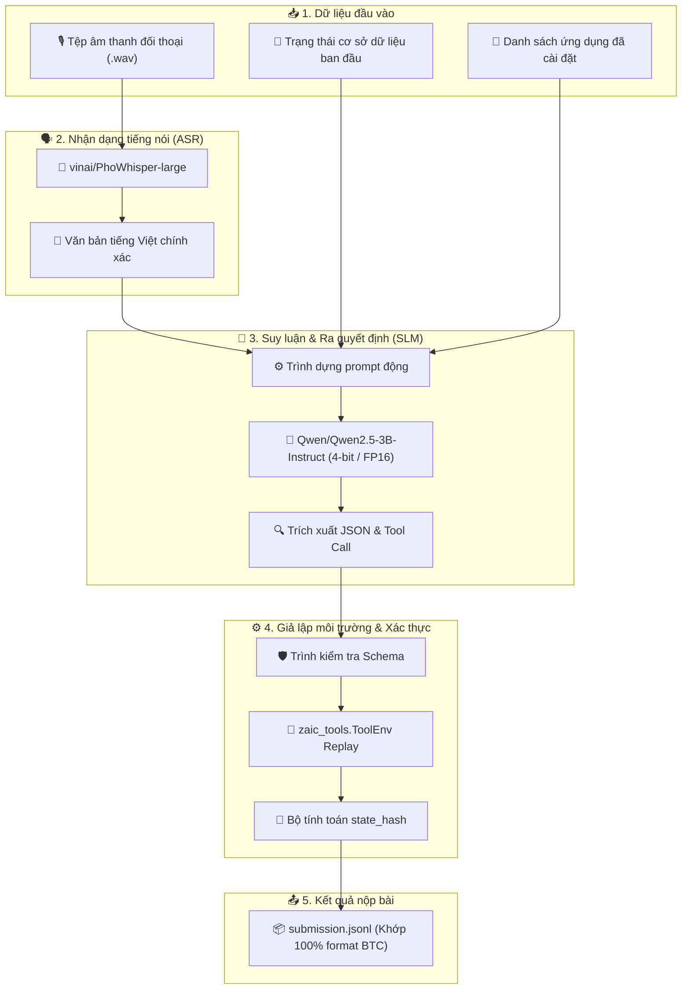
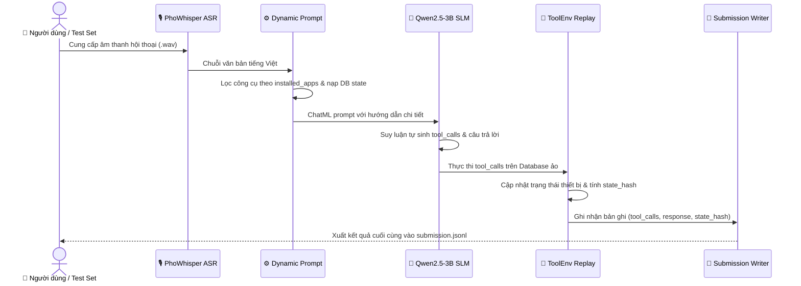

# Zalo AI Challenge 2026 — LifeMate Offline Agent Pipeline

_Hệ thống tác nhân AI ngoại tuyến hỗ trợ cuộc sống thông minh (LifeMate) đạt chuẩn thể lệ Docker Zalo AI Challenge 2026._

[](https://www.python.org/)
[](https://pytorch.org/)
[](https://huggingface.co/Qwen/Qwen2.5-3B-Instruct)
[](https://huggingface.co/vinai/phowhisper-large)
[](https://www.docker.com/)
[](https://challenge.zalo.ai/)

---

## 📋 Tổng quan dự án

Dự án cung cấp một đường ống xử lý (pipeline) hoàn chỉnh, tự động và độc lập cho bài toán **LifeMate — Trợ lý điều khiển cuộc sống thông minh** thuộc khuôn khổ cuộc thi **Zalo AI Challenge 2026**.

Mục tiêu của bài toán là tiếp nhận chuỗi âm thanh hội thoại đời thực bằng tiếng Việt, nhận dạng yêu cầu người dùng, tương tác với các ứng dụng đã cài đặt (nhà thông minh, ngân hàng, thời tiết, giao thông...) và thực thi các thao tác (`tool_calls`) chính xác nhằm đồng bộ trạng thái hệ thống (`state_hash`).

### Các điểm nổi bật
- **Tuân thủ 100% thể lệ ngoại tuyến (Offline Docker):** Mô hình suy luận ngôn ngữ nhỏ (SLM) dưới 5 tỷ tham số (`Qwen2.5-3B-Instruct`), độ dài ngữ cảnh $\le 16\text{K}$, không gọi API bên ngoài (OpenAI/Gemini/Anthropic).
- **Nhận dạng tiếng Việt chính xác cao:** Tích hợp `vinai/PhoWhisper-large` xử lý triệt để ngữ âm tự nhiên tiếng Việt, từ địa phương và số liệu giao dịch.
- **Tái lập môi trường nội bộ (ToolEnv Replay):** Tự động mô phỏng thay đổi dữ liệu trên thiết bị, tính toán `state_hash` chuẩn xác nhằm đạt điểm tuyệt đối cho từng lượt hội thoại.
- **Tối ưu hóa tài nguyên:** Chạy mượt mà trên phần cứng giới hạn (GPU 16GB VRAM, Google Colab T4 miễn phí) với định dạng 4-bit/FP16.

---

## 🏗️ Kiến trúc hệ thống

Hệ thống được thiết kế theo kiến trúc module sâu (*Deep Modules*), tách biệt hoàn toàn giữa tầng nhận dạng giọng nói, tầng lý luận ngữ nghĩa và tầng mô phỏng trạng thái công cụ.



---

## 🔄 Luồng xử lý chi tiết (Execution Pipeline)

Mỗi lượt hội thoại (`turn`) trong tệp dữ liệu được xử lý tuần tự và cô lập qua các bước:



### Bảng đối sánh thành phần kỹ thuật

| Thành phần | Công nghệ lựa chọn | Mục đích sử dụng | Ưu điểm cốt lõi |
| :--- | :--- | :--- | :--- |
| **ASR Model** | `vinai/PhoWhisper-large` | Chuyển đổi audio $\rightarrow$ text | Tối ưu hóa đặc thù ngữ âm và từ viết tắt tiếng Việt |
| **SLM Core** | `Qwen/Qwen2.5-3B-Instruct` | Hiểu ngữ cảnh & Function Calling | Điểm chuẩn Function Calling vượt trội trong phân khúc $< 5\text{B}$ |
| **Quantization** | `bitsandbytes` (NF4 / FP16) | Nén bộ nhớ mô hình | Chạy vừa vặn trong 8GB–16GB VRAM của Colab T4 |
| **Environment** | `zaic_tools.ToolEnv` | Thực thi công cụ nội bộ | Đảm bảo `state_hash` khớp tuyệt đối với server chấm của BTC |

---

## 📂 Cấu trúc mã nguồn

```
ZaloAIC-Lifemate/
├── docker/
│   ├── Dockerfile                  # Cấu hình container chạy Offline cho Vòng Chung kết
│   └── run.sh                      # Kịch bản khởi chạy container (nhận input/output mount)
├── notebooks/
│   └── LifeMate_Colab_Inference.ipynb # Notebook chạy trực tiếp trên Google Colab T4 SSD
├── src/
│   ├── agent.py                    # Vòng lặp suy luận tác nhân & thực thi ToolEnv
│   ├── asr.py                      # Pipeline nhận dạng giọng nói PhoWhisper-large
│   └── prompts.py                  # Bộ dựng ChatML prompt lọc tool theo ngữ cảnh
├── asr_public_test_pho.json        # Bản đệm nhận dạng văn bản 1,933 file audio public test
├── evaluate.py                     # Bộ đánh giá điểm số chuẩn của Ban tổ chức
├── requirements.txt                # Danh sách thư viện Python phụ thuộc
├── submission.jsonl                # File kết quả mẫu đã được thẩm định tính hợp lệ
└── README.md                       # Tài liệu hướng dẫn sử dụng dự án
```

---

## 🚀 Hướng dẫn thực thi

### 1. Chạy trên Google Colab với GPU T4 (Khuyên dùng)

Quy trình đã được đóng gói tự động hóa 100% trong file Notebook, tận dụng ổ cứng SSD cục bộ (`/content/data`) để đạt tốc độ cao nhất:

1. Đặt tệp dữ liệu gốc `train+public_test.zip` vào bất kỳ đâu trên Google Drive cá nhân của bạn.
2. Mở [Google Colab](https://colab.research.google.com/) $\rightarrow$ Chọn tab **GitHub** $\rightarrow$ Nhập:
   ```text
   duylhm/ZaloAIC-Lifemate
   ```
3. Nhấp chọn notebook: `notebooks/LifeMate_Colab_Inference.ipynb`.
4. Thiết lập phần cứng: Vào **Runtime** $\rightarrow$ **Change runtime type** $\rightarrow$ Chọn **T4 GPU** $\rightarrow$ Bấm **Save**.
5. Nhấn **Runtime** $\rightarrow$ **Run all** (`Ctrl + F9`).
   - Notebook sẽ tự động tìm kiếm file zip trên Drive và giải nén siêu tốc vào SSD cục bộ.
   - Chạy ASR và nạp trọng số mô hình `Qwen2.5-3B-Instruct`.
   - Tiến hành suy luận và tự động kích hoạt tải file `submission.jsonl` về máy tính khi hoàn tất.

### 2. Chạy cục bộ trên máy tính (Local Environment)

Yêu cầu môi trường: Python 3.10+, CUDA Toolkit 12.1+ và GPU tối thiểu 12GB VRAM.

```powershell
# 1. Cài đặt các thư viện phụ thuộc
pip install -r requirements.txt

# 2. Chạy suy luận trên tập dữ liệu
python -m src.agent --input_dir "data/public_test" --output_file "submission.jsonl"

# 3. Đánh giá tính hợp lệ của tệp kết quả
python evaluate.py --pred submission.jsonl --gold data/public_test/ground_truth.jsonl
```

### 3. Đóng gói Docker nộp bài Vòng Chung kết (Final Round)

Theo quy định của BTC, mã nguồn vòng chung kết sẽ được build thành Docker image độc lập không có kết nối Internet:

```bash
# Xây dựng Docker image
docker build -t lifemate-agent:latest -f docker/Dockerfile .

# Kiểm thử chạy offline với volume mount
docker run --rm --gpus all --network none \
    -v /path/to/test_data:/data/test \
    -v /path/to/output:/output \
    lifemate-agent:latest /data/test /output/submission.jsonl
```

---

## 📊 Cơ chế chấm điểm & Metric

Hệ thống điểm của Zalo AI Challenge — LifeMate được tính toán dựa trên tính chính xác đồng thời của trạng thái cơ sở dữ liệu và câu phản hồi ngôn ngữ:

$$\text{Final Score} = \frac{1}{N} \sum_{i=1}^{N} \text{SampleScore}(i)$$

Quy tắc phạt nghiêm ngặt của Ban tổ chức:

> ⚠️ **Điều kiện tiên quyết về State Hash:** Nếu giá trị `state_hash` dự đoán của một sample không khớp chính xác 100% với `state_hash` thực tế của BTC (`hash_sys != hash_gold`), điểm số của sample đó sẽ **bị tính bằng 0.0**, bất kể câu trả lời phản hồi có chính xác hay không.

<details>
<summary><b>Chi tiết công thức tính điểm thành phần</b></summary>

Khi `state_hash` hợp lệ, điểm số lượt hội thoại được tính kết hợp giữa:
1. **Tool Matching (F1-score):** Độ chuẩn xác giữa tên công cụ và bộ tham số truyền vào.
2. **Response Quality (ROUGE / BLEU / BERTScore):** Độ mạch lạc, đầy đủ thông tin và tính tự nhiên của câu trả lời người dùng.
3. **Out-of-Scope Detection:** Khả năng từ chối xử lý chính xác khi người dùng yêu cầu hành động nằm ngoài danh mục ứng dụng được cài đặt (`installed_apps`).
</details>

---

## 🛡️ Tuân thủ thể lệ cuộc thi

Dự án được xây dựng bám sát 100% văn bản quy định chính thức:

- [x] **Giới hạn kích thước mô hình:** Sử dụng `Qwen2.5-3B` ($< 5\text{B}$ tham số theo công bố của nhà sản xuất).
- [x] **Ngữ cảnh tối đa:** Giới hạn context length nghiêm ngặt dưới $16\text{K}$ tokens.
- [x] **Hoàn toàn ngoại tuyến:** Không phụ thuộc vào OpenAI, Anthropic hay bất kỳ dịch vụ đám mây bên ngoài nào trong thời gian inference.
- [x] **Môi trường tự chứa:** Đầy đủ Dockerfile và script `run.sh` theo đúng mẫu chuẩn của BTC.

---

## 👥 Tác giả & Bản quyền

- **Tác giả:** Lưu Hoàng Minh Duy ([@duylhm](https://github.com/duylhm))
- **Mã nguồn:** Phát triển phục vụ cuộc thi [Zalo AI Challenge 2026](https://challenge.zalo.ai/) — Track LifeMate.
- **Giấy phép:** [MIT License](LICENSE)
